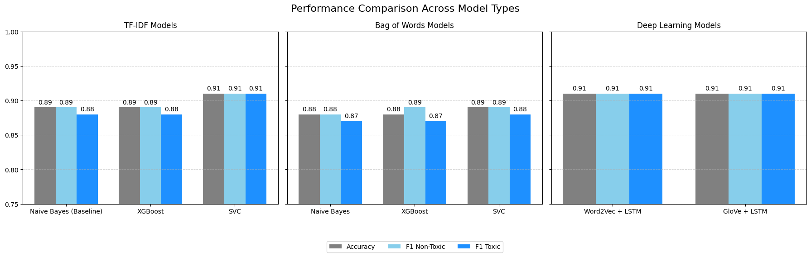

# Toxic Comment Classifier

Detecting toxic comments automatically, so that human moderators only need to review the cases a model is unsure about.

I benchmarked **8 model pipelines** (6 classical, 2 deep learning) on **32,450 comments** from the Jigsaw Toxic Comment dataset. The best classical pipeline, **TF-IDF + SVC**, raised toxic-class F1 from a **0.88 baseline to 0.91**, the same score as the two LSTM models, while training far faster and staying interpretable.



## The problem

Online communities, game communities included, receive more comments than any moderation team can read. The question I wanted to answer was practical: **does a toxicity filter need deep learning, or is a well-chosen classical model good enough?**

## Approach

1. **Data.** The Jigsaw corpus has 159,571 Wikipedia talk-page comments with six toxicity labels. I merged them into one binary label (toxic / non-toxic). Only about 10% of comments were toxic, so I down-sampled the non-toxic class to get a balanced set of 16,225 + 16,225 = 32,450 comments (seed 42, 80/20 train/test split).
2. **Pre-processing tuned per model family.** One configurable cleaning function, with different settings for each representation:
   - TF-IDF: stemming, punctuation removed, **stopwords kept** (in toxic speech, words like "you are" carry meaning).
   - Bag of Words: stemming, stopwords and punctuation removed, to reduce dimensionality.
   - Embeddings: lemmatization, punctuation and stopwords kept, to match how pretrained vectors were built.
3. **Baseline.** TF-IDF + Multinomial Naive Bayes, a well-established reference point for this dataset.
4. **Comparison.** Naive Bayes, XGBoost and SVC on both TF-IDF and Bag of Words, plus LSTM networks on Word2Vec (trained on this dataset) and GloVe (pretrained) embeddings.

## Results

| Model | Representation | Accuracy | F1 (toxic class) |
|---|---|---|---|
| Naive Bayes (baseline) | TF-IDF | 0.89 | 0.88 |
| XGBoost | TF-IDF | 0.89 | 0.88 |
| **SVC** | **TF-IDF** | **0.91** | **0.91** |
| Naive Bayes | Bag of Words | 0.88 | 0.87 |
| XGBoost | Bag of Words | 0.88 | 0.87 |
| SVC | Bag of Words | 0.89 | 0.88 |
| LSTM | Word2Vec | 0.91 | 0.91 |
| LSTM | GloVe | 0.91 | 0.91 |

## What I learned

- **TF-IDF + SVC matched the LSTMs** at a fraction of the cost: a linear model on sparse features, with no neural network, no embedding files and no multi-epoch training, and its top-weighted n-grams can be inspected directly. For a real-time moderation system, this is the model I would ship first.
- **The models fail differently.** SVC had higher precision (fewer false accusations); Word2Vec + LSTM had higher recall (caught more toxic comments). The right choice depends on whether a platform fears missing abuse more than wrongly flagging players.
- **Bag of Words trailed by about 0.02 F1.** Weighting words by rarity (IDF) or using dense embeddings is what closes the gap on short, noisy text.

## Tech

Python, pandas, scikit-learn, XGBoost, NLTK, spaCy, Gensim (Word2Vec), TensorFlow / Keras (LSTM), GloVe, matplotlib

## Run it

The dataset and GloVe vectors are not included because of their size.

1. Download `train.csv` from the [Kaggle Jigsaw Toxic Comment Classification Challenge](https://www.kaggle.com/c/jigsaw-toxic-comment-classification-challenge/data) and put it in `Dataset/train.csv`.
2. Download `glove.6B.zip` from [Stanford GloVe](https://nlp.stanford.edu/projects/glove/) and put `glove.6B.100d.txt` in the project root.
3. Install dependencies and open the notebook:

```bash
pip install -r requirements.txt
python -m spacy download en_core_web_sm
jupyter notebook toxic_comment_classification.ipynb
```

## Context

Built as the midterm project for the Natural Language Processing module of my BSc Computer Science (University of London, Goldsmiths). The full write-up, including references, is inside the notebook.
